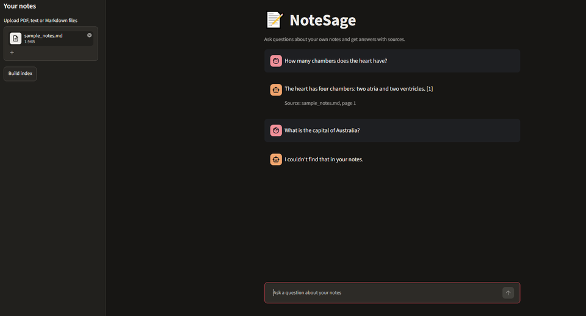

# NoteSage

Ask questions about your own notes and get answers with citations. Upload PDF,
text or Markdown files, and NoteSage retrieves the relevant passages and has a
local language model answer from them, or tells you it couldn't find the answer.



## Features
- Loads PDF, `.txt` and `.md` files, page by page
- Semantic search with sentence-transformers and a FAISS index
- Answers from a local model through Ollama, so no API key or cloud account
- Cites the file and page behind each answer
- Says "I couldn't find that in your notes" instead of guessing, using a relevance threshold measured from data
- Streamlit web interface and command-line tools

## How it works
1. **Ingest:** files are loaded and split into overlapping chunks that remember their source file and page.
2. **Index:** each chunk is embedded (`all-MiniLM-L6-v2`) and stored in a FAISS inner-product index.
3. **Retrieve:** a question is embedded and the top matching chunks are returned with similarity scores.
4. **Gate:** if the best score is below `MIN_SCORE` (0.25), the model is never called.
5. **Answer:** the remaining chunks go into a prompt that tells the model to use only the notes and cite them; the answer is shown with its sources.

## Setup
Requires Python 3.10+ and [Ollama](https://ollama.com).

```powershell
git clone https://github.com/DevNadhem/notesage.git
cd notesage
python -m venv .venv
.venv\Scripts\Activate.ps1
pip install -r requirements.txt
ollama pull llama3.2
```

The first run downloads the embedding model (about 90 MB).

## Run the web app
```powershell
python -m streamlit run app.py
```
Upload your notes in the sidebar, click **Build index**, and ask questions.


## Command-line tools
```powershell
$env:PYTHONPATH = "src"
python -m notesage.build_index notes.pdf --out data\index
python -m notesage.search data\index "your question"
python -m notesage.ask data\index "your question"
python -m notesage.evaluate docs\sample_notes.md
python -m notesage.calibrate docs\sample_notes.md --chunk-size 300 --overlap 50
```

## Tests
```powershell
pytest -m "not slow"
```
The `slow` test uses the real embedding model and runs with plain `pytest`.

## Evaluation
Retrieval hit rates for different chunk sizes and the derivation of the
relevance threshold are in [`docs/EVALUATION.md`](docs/EVALUATION.md).

## Troubleshooting
- **"Ollama is not running"**: start the Ollama app, then reload the page.
- **"Model 'llama3.2' is not installed"**: run `ollama pull llama3.2`.
- **A file was skipped**: the app lists the reason (unsupported type, scanned PDF with no text, unreadable, or too large).
- **"I couldn't find that in your notes" although the answer is there**: small local models can be literal. Try the notes' own wording (for example "chambers" instead of "rooms").

## Limitations
- Scanned PDFs have no extractable text, and OCR is not supported.
- The relevance threshold was tuned on one small notes file and may need re-tuning for other documents.
- Questions that combine an answerable and an unanswerable topic return "not found"; ask them separately.
- The index lives in the session and is rebuilt after a page reload.

## Project history
Built in four short sprints (ingestion, retrieval, generation, UI), compressed
to fit a deadline. See the [roadmap](docs/ROADMAP.md), the
[changelog](CHANGELOG.md), the closed milestones and the pull requests.

## AI assistance
This project was planned and developed with help from an AI assistant (Claude),
including code suggestions and debugging. I reviewed, ran and tested the code,
and the evaluation numbers come from my own runs.